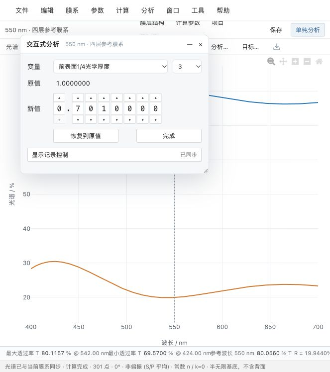

# 0.2.3-dev.3：交互式分析、手动环境与膜层分组

## 参数输入

入射介质、基底、出射介质支持键入项目材料完整名称、已知目录材料完整名称，或常数折射率 n（例如 `1.0`、`1.52`）。数字会建立明确标记的用户常数介质，不修改原始色散材料。名称没有定义时明确报错，不猜材料参数。已有项目材料仍可从输入建议中选择。

半无限基底只有进入基底的边界，原界面因此禁止独立出射介质，造成“不能改”的误解。现在编辑独立出射介质或基底厚度会明确切换有限厚非相干模型；界面即时显示新模型。波长、步长、参考波长、角度、厚度可手动输入；模型、偏振和表面方向保留有效类别选项。新光源/探测器响应必须先定义真实响应表，不能凭名称生成数据。

## 紧凑调膜

按用户提供的 TFC 界面组织，而非通用调节面板：默认 420×300（最小 380×280；已保存的旧窗口尺寸会保留，可拖动边框缩小并自动记住），变量与层号/组号同一行，随后为原值、新值逐位编辑、“恢复到原值”“完成”和“显示记录控制”。

变量分为前表面/后表面 1/4 光学厚度、前表面/后表面物理厚度、组系数、入射角及整体膜厚系数。每个数位有独立上下按钮，可直接替换数字，并支持上下方向键调整、左右方向键移动。显示7位小数，不将显示舍入回写未编辑的膜厚；恢复到原值保持本轮原始项目快照精确一致。

“完成”保留当前调整并收起窗口，项目仍需保存。“显示记录控制”默认折叠，包含整值输入、步长、滑块、最多100条本轮参数记录及恢复、撤销、重新载入。参数记录不冒充已保存的光谱曲线历史。

所有可见入口统一为“交互式分析”；原“计算光谱”按钮、菜单和命令显示名改为“单纯分析”，内部命令ID及计算逻辑不变。主按钮保持稳定名称，避免每帧显示“更新中”造成闪动。

可变材料N/K、混合比例、电场、膜厚监控等尚未完成的变量没有伪装成可用项；本次未新增这些专业计算功能。

## 分组与系数

膜层表最后增加“组”列，支持 F2/双击、Enter/Tab、复制粘贴及共享撤销。0 为不分组，1–999 为组号；同一组可以包含正背面膜层。

“交互式分析 → 组系数”选择已有组。物理厚度始终是计算实际值，按 `新系数 / 本轮原系数` 缩放组内实际厚度，其他组不变；连续预览均相对于本轮基准，不重复累乘。修改分组本身不修改膜厚。TFD 新导入保留组号及组系数，原系数只在导入时计入一次。

旧项目保持已有实际厚度；不根据可能已过期的导入记录按行号猜测旧项目分组。可重新导入 TFD 获取分组，或直接在表中指定。原系数为零且实际厚度归零时，不猜测恢复厚度，需先设置该组实际厚度。

## 实时计算

桌面和本地浏览器开发桥接复用常驻 Python 计算进程，避免每次重新启动 Python/NumPy。服务只接受 calculate，拒绝任何存储操作；不保存项目副本或使用 Workspace。实际项目状态仍由主窗口唯一管理，保存与目录操作继续使用原流程。进程退出后下次计算重新建立；主窗口退出回收进程。

取消每次编辑后的 180 ms 延迟，有空即计算；保留单一运行任务和仅最新待计算任务。连续调膜可以展示本轮已完成的中间帧，状态仍标记继续更新；最新最终结果严格对应当前输入。跨项目、跨工作区或其他窗口修改后的旧帧不会作为预览，旧结果不能覆盖最新最终结果。保留当前曲线；更新不清屏，不添加加载遮罩。调膜时保留图表缩放；切换项目或波段仍可重置。

本机原生窗口联动验收通过，301 点小膜系热计算往返约 5 ms（含 Tauri IPC；仅本机单次样本，不承诺任意复杂膜系耗时）。64 项 Python、50 项 TypeScript、8 项打包/迁入、Mac 12 项 Rust 与25项既有数值回归通过，Golden 最大误差仍为 7.838345368327282e-7 个百分点。Windows 最新源码已通过构建及全部8份原生运行检查，[实际作业](https://github.com/LiuYiMing007/tfc-workbench/actions/runs/42240591525/job/127969530192)。macOS 使用同源码本机原生程序验收及打包，本报告不冒称排队中的 macOS CI 作业通过。

## 范围

未修改 TMM 公式、材料常数或原 Golden。组号和系数为项目可选元数据，厚度始终直接供计算使用。没有开发自动优化或 AI。当前为开发验证版，未创建正式标签或 Release。

## 性能及实际操作证据

[常驻引擎基准](v0.2.3-dev.3-warm-engine-benchmark.json)：合成 59 层、601 点、非相干有限基底，旧进程调用中位数约 905 ms；常驻第一次约 766 ms，随后 20 次中位数约 34 ms、最大约 46 ms，21 次完整输出与旧流程相同。此统计不包含前端绘图，不承诺所有机器与膜系达到该速度；第一次仍需初始化。

本地预览实际完成输入出射 n=1.1、有限基底自动切换、表格第4层指定组2、组系数1→1.10的实时光谱变化，以及撤销后保留组变量/0.01步长继续调节。原生 Mac 的8个窗口及常驻计算通道检查通过。

最终界面已通过本地实际操作：按 0.001 数位即时更新曲线；点击“完成”收起窗口并保留结果，重新打开后原值正确载入刚保留的0.7010000。窗口最小高度保证主要按钮及记录控制完整可见。

## 最终双平台包与来源

源码为 `12409e8cb8b8c5dc4532d1ee43590ec1f2e09427`。Mac 本机及 Windows CI 的菜单、8个工具窗口、逐位控件、常驻引擎、材料、TFD、环境计算、工作区和便携位置验收通过。24个环境参考值的跨平台最大差异为 `7.105427357601002e-14` 个百分点；小膜系原生热计算样本 Mac 5 ms、Windows约11.8 ms，仅为本次合成样本。

程序位于 `release/0.2.3-dev.3/assets/`，包含Mac、Windows和双系统合并ZIP及SHA256。包内不含用户Workspace、数据库或原始膜系；升级只替换现有TFC目录内的macOS/Windows程序子目录，保留Workspace、Workspaces、.tfc。

[双平台来源、数值和校验值](v0.2.3-dev.3-cross-platform.json) · [Windows逐位控件与窗口](v0.2.3-dev.3-windows-ci-window-ipc.json) · [Mac原生窗口](v0.2.3-dev.3-macos-local-window-ipc.json) · [组号及文件往返](v0.2.3-dev.3-group-files.json)。实体SSD换盘符、人工显示缩放与双显示器未冒充自动验收。
