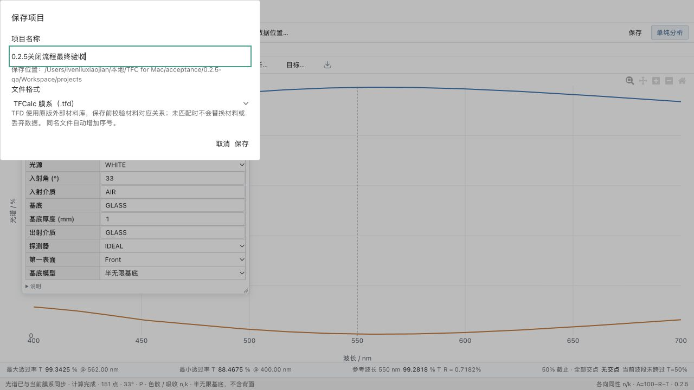

# 0.2.5 保存与关闭流程修复

状态：共享代码已修复，Mac 与浏览器验证通过；Windows 必须重编译复验，尚未正式发布。此记录不覆盖原 Windows 缺陷证据。

## 调整

- 未保存确认只返回取消、丢弃、保存三个选择，立即结束该确认窗口；项目协调器随后处理命名与保存。移除确认组件自身等待保存的长期状态，避免与命名窗口叠加并留在“正在保存”。
- 命名期间禁用其它工具的项目编辑及菜单命令；取消命名、取消关闭均保留当前未保存修改。保存失败返回原项目，不执行关闭。
- 新增仅主协调窗口可调用的 `tool_hide_all`：在桌面宿主一次隐藏全部真实工具窗及光谱窗，与工具窗创建串行；Windows 独立菜单保持。浏览器对应一次更新窗口可见性。
- 项目关闭/打开使用窗口流程序号，过时的环境窗口恢复任务不再继续弹出后续工具窗。
- 窗口 IPC 检查新增 `all_work_windows_hidden`、`reopen_after_hide_all`，脚本强制检查，后续 Windows 应运行同一检查。

## 实际验证

- 75 Python、67 TypeScript、9 打包/迁移测试通过；14 项 Mac Rust 测试、前端及原生构建通过。未修改计算核心、材料或文件格式。
- Mac 17 个工具窗口实际 IPC：全部隐藏及隐藏后重新打开通过；原生菜单检查通过。
- 浏览器：导入样本、入射角改为 33°；关闭→保存后只有命名窗，原确认数量为 0；命名期间环境不能编辑；取消命名保留修改；取消关闭保留修改；再次命名保存后仅剩菜单。实际 TFD 的 ENVIRON 记录为 33°。
- Mac 原生：导入独立样本，入射角 30→34°；关闭→保存并继续→命名 `Mac原生关闭保存验收`，文件实际写出，ENVIRON 保留 34°；工作窗口隐藏，应用进程继续运行。界面操作与自动 IPC 互相补充，不能代替 Windows 实测。
- 更新后的 Mac 候选包已重打，便携定位、目录搬迁与精确复算检查通过；没有替换 GitHub Release。

## Windows 下一步

读取本文对应提交后重新编译，不使用先前 ZIP。重跑 `validate_window_ipc_release.py` 并确认新增两项为 true；在无游戏抢占前台条件下复验：

1. 修改已打开项目→保存并继续→命名→保存，确认不叠加、不转圈、所有工作窗隐藏、文件内容正确。
2. 已保存项目修改后保存关闭，以及取消命名、取消关闭、保存失败均保留正确状态。
3. 同时打开 materialdata/distribution/rear 后选择不保存，全部工作窗隐藏，只留菜单；再打开项目恢复正常。
4. 补原记录尚未覆盖的基底增删编辑、组联动、外部位置另存为。更新人工记录及包 SHA-256，将包回传 Mac。旧 Windows 报告不视为新修复通过。

## 截图

保存确认已结束，只保留命名窗口：

保存成功后全部工作窗口隐藏：

