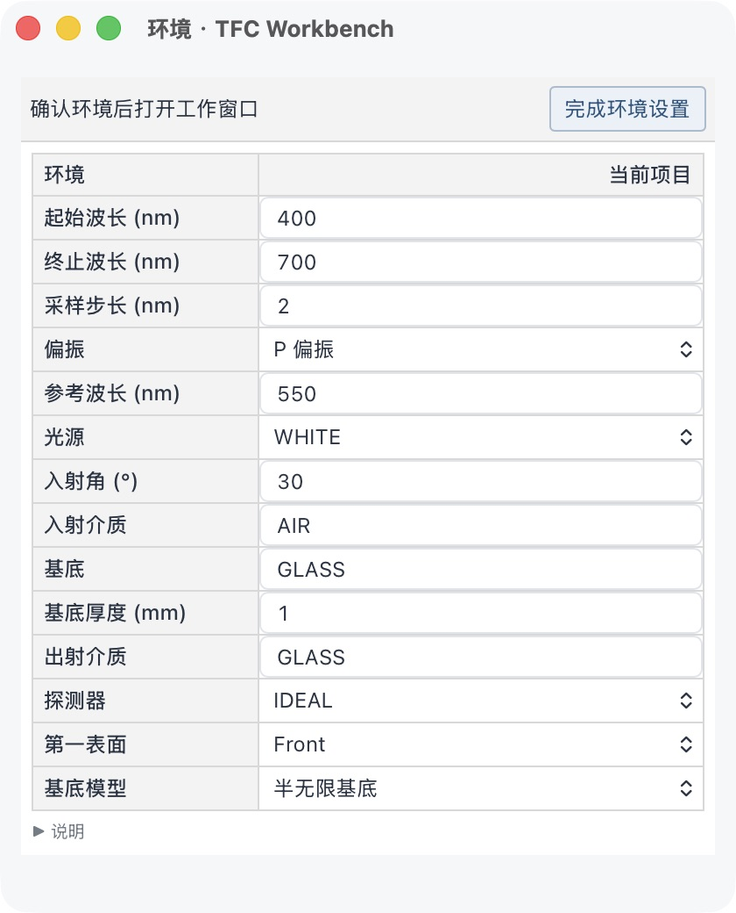
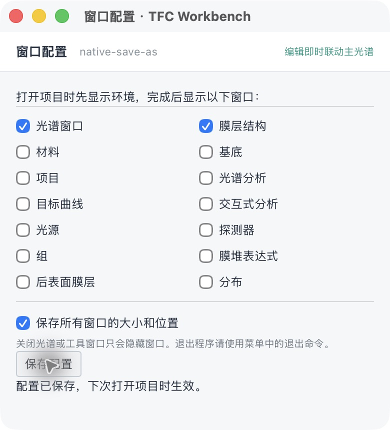

# TFD 保存、环境与窗口流程预览

2026-11-09。基于 0.2.5-dev.2 的未编号预览，不创建或覆盖版本标签，不替换已发布安装包。

## 使用流程

- 文件 → 新建 / 打开项目：先隐藏工作窗口，只打开“环境”。计算波段、采样、偏振与原环境项目合并在同一张属性表。确认后点击“完成环境设置”。
- 窗口 → 配置：选择完成环境后自动打开的窗口，光谱也可不勾选。默认光谱与膜层结构。不强制弹出所有窗口。
- 关闭光谱只隐藏它，项目协调器及工具窗口继续运行；窗口 → 主光谱窗口恢复。Mac 用应用菜单退出；Windows 在帮助菜单提供退出命令，文件菜单继续维持五项。
- 保存项目：首次命名并选择格式，默认 TFD；写到当前 Workspace 的 projects 目录，后续保存更新该工作区项目。旧客户端 API 未指定格式时继续保存 JSON。
- 另存为：桌面使用系统原生保存窗口，选择目录及文件名，支持 .tfd 与 .tfc.json。Mac 原生窗口可直接编辑扩展名；Windows 提供文件类型筛选。取消不会修改项目。另存成功后下一次普通“保存”仍写 Workspace，不在项目中绑定外部绝对路径。
- 保存所有窗口大小和位置：配置存于便携项目 .tfc/window-layout.json，Mac / Windows 分别记录屏幕布局；重开程序恢复大小位置，打开哪些工具仍由配置决定。浏览器仅记忆其浮动工具窗口，使用本机浏览器存储。

## TFD 记录与材料

写出原版 VERSION 1 星号分隔文本、CRLF 行尾和 GB18030 编码，不是 JSON 改扩展名。记录包括 CONFIG、ENVIRON/2/3、GROUPS/GROUP、LAYERS/LAYER、LAYERS2/LAYER2、ENVIRNS/ENVIRN、TRDATA6、COMMENTS 和 EOF。实际膜厚除以组系数后写入组前物理厚度，QWOT 按原材料和参考波长换算，正背面与偏振一并回读验证。

导入文件保存完整原始记录；已支持的字段更新，其余目标、分析和未知记录按原顺序保留，膜层与组的附加标志保留。没有原记录的未知设置不推测含义或伪造功能。

TFD 引用原版外部材料库。导出核验 MATERIAL / SUBSTRAT 对应名称及完整 n/k 数据，常数与等价平坦表允许匹配；更改过的同名材料不会被原记录悄悄替换。完整快照仍保存在 Workspace 数据库；完整项目 JSON 可保留本软件专有数据。

当前不能无损写成兼容 TFD 的情况会在写入前拦截并提供完整 JSON 选项：没有核验原库对应的材料、未核验外部响应文件的自定义光源/探测器、多环境、相干块状基底、新增本软件响应/目标/波段配置，以及原版会解释成半无限的特定有限基底配置。已有原版未知记录可以原样保留，不代表已经实现其计算语义。

## 分布是什么

新增参数 → 分布，含 EQUAL 参考表，可新增、编辑和删除角度 / 相对强度记录，最多 1001 点。数据描述锥角内各角度的权重，与光源随波长的强度数据不同。

本预览只管理分布数据，没有实现锥角平均、偏振耦合或把分布代入现有单角 R/T。新增记录使用完整 JSON 保存，同时在 Workspace/materials/distributions 下生成单项具名 .distribution.json 文件。TFD 外部分布文件写出和角度积分仍未实现，不将界面存在当作计算已完成。

## 本机验证

- 75 项 Python、64 项 TypeScript、9 项打包/迁移测试通过；13 项 Rust 测试通过。
- 25 项原有数值回归通过，Golden 最大误差约 7.84e-7 个百分点；Optical Core 公式未修改。
- 实际冻结引擎 TFD 写出、回读和 R/T 对照通过；测试样本最大差值 0 个百分点。含组系数、未分组层和偏振；单元测试另覆盖有限基底、背膜和 Back 方向。
- Downloads 中原始对比样本也完成写出回读：R/T 最大差值 0，未建模原记录保持，原件哈希未变；未上传样本。
- 原生菜单路由、关闭光谱保持进程并恢复、17 个工具窗口的前端 IPC 与共享状态检查通过。旧 settings ID 仅保留内部兼容，不再有第二个“计算参数”菜单。
- Mac 实际点击验证：原生打开 TFD → 只显示环境 → 完成后显示配置的工作窗口；从膜层窗口菜单调用另存为，在工作区之外改名生成真实 TFD；窗口配置勾选并保存后，便携配置文件含窗口尺寸记录。另存之后普通保存确实生成 Workspace/projects 中的具名 TFD；手动关闭光谱后从菜单恢复，同一项目和光谱仍在。
- 浏览器实际验证：具名 TFD 保存、重新打开、环境优先；取消光谱自动打开，仅显示膜层，仍可从菜单恢复光谱；分布两点数据新增成功。

证据：project-flow-native-menu.json、project-flow-window-ipc.json、project-flow-project-flow.json、project-flow-optics.json；截图见下。本次代码提交 a32b4fe 的双平台检查：[GitHub Actions 42498655881](https://github.com/LiuYiMing007/tfc-workbench/actions/runs/42498655881)。Mac 作业已通过；记录时 Windows 作业仍在运行，未预先记为通过。不冒称物理 Windows 点击测试。原版 TFCalc 尚未实际打开本次新写出的文件；仍需原版软件验收，不能只凭本软件回读宣称全部兼容。

## 主要修改文件

- engine/exporters/tfd.py、engine/importers/tfd.py、engine/application.py：真实 TFD 写出、记录保留与纯导出接口。
- engine/repository.py、engine/file_exports.py、engine/models.py：具名文件、格式选择和分布数据校验及单项文件。
- src/App.tsx、src/SaveProjectDialog.tsx、src/CompactTools.tsx、src/MediumInput.tsx：保存与打开流程、统一环境、材料名称显示。
- src/windowPreferences.ts、src/WindowConfiguration.tsx、src/DistributionWindow.tsx、src/distribution.ts：配置与分布窗口。
- src/tools/、src/menus/、src/design/compact.css、src/SpectrumChart.tsx：窗口投影、浏览器兼容、菜单和隐藏时图表尺寸处理。
- src-tauri/src/main.rs、tools.rs、menus.rs、menu_check.rs：原生保存窗口、生命周期与便携布局。
- engine/tests/test_tfd_export.py、tests/windowPreferences.test.ts、tests/menus.test.ts、scripts/validate_project_flow_release.py 及窗口/菜单检查：回归与双平台流水线。

不改 TMM 公式、原始材料常数或原始 Golden，不上传个人 Workspace；未开发 AI 或优化功能。
