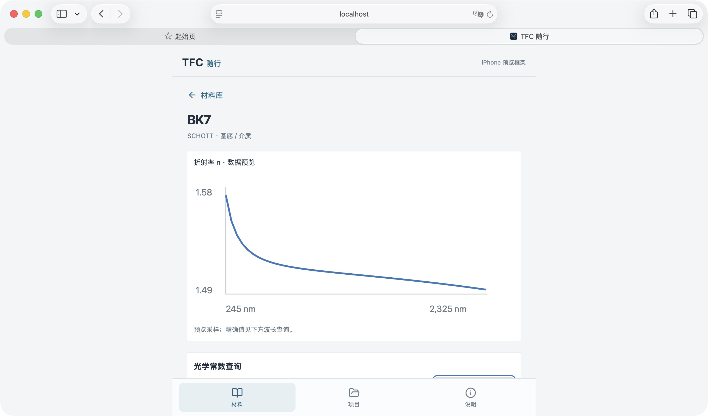

# iPhone 离线与真机验收记录（进行中）

日期：2026-11-04。此记录区分 Mac Safari 实测与用户 iPhone 实测，不能将前者视作后者通过。

## 当前结论

- 独立程序包含完整材料与光学图标，静态构建和缓存检查通过。
- Mac Safari：资源检查 6/6；停止仅供 Mac 验收的本地 HTTP 服务后，重载、搜索 BK7、查看详情与 587.6nm 查询 n=1.5167984 成功。另一个服务保持手机 HTTPS 测试在线。
- iPhone：用户可以配合测试，第一轮反馈“检查本机离线资源没反应”。尚未收到修正版结果，主屏幕图标、飞行模式冷启动、项目持久保存、导入与导出落盘均未标记通过。
- 没有完整 Xcode、模拟器或 USB 连接的 iPhone；目前通过用户在 Safari 的实际操作协同验收，没有冒称远程控制手机。

## 为验收补充的改进

1. “说明”增加设备与离线验收区，显示安全连接、浏览器/主屏幕模式及缓存数量。缓存完整本身不代表已经通过物理断网验收。
2. 离线状态不再仅凭 Service Worker ready 宣告成功。前台核对本页面当前版本的 HTML、模块、CSS、manifest 和两种图标是否存在于同一份缓存，避免读取旧版本缓存或等待后台进程回信。
3. 整个缓存检查设 8 秒超时，并显示具体错误。先前接口等待的部分路径没有完整覆盖超时，本次统一覆盖。
4. 缓存按部署路径分区，只清理同路径的旧版本。根路径与 /verify/ 等测试路径互不删除缓存，保留上一个版本的资源；不删除 IndexedDB 中的项目。
5. 文件选择不再以 accept 提示限制类型，随后仍执行既有大小、JSON 格式和项目结构验证。Mac Safari 原文件选择器出现无法确认 JSON 的情况，放宽提示后的原生自动化选择仍未确认成功，因此不得报告导入/导出真机问题已解决。
6. 校验脚本新增完整/缺失缓存反馈检查；TypeScript 新增部署子目录与当前哈希资源路径检查。

## 测试环境与数据隔离

用户明确同意临时 HTTPS 测试链接，范围仅为程序、图标、内置材料，不包含 Workspace 或实验膜系。临时服务只提供单独复制的静态构建目录，绑定本机回环地址，HTTPS 隧道连接该服务。外部请求 Workspace 路径返回 404。

运行 Cloudflare 官方临时工具前，对照官方 GitHub release API 的资产 SHA256 校验下载包，结果一致。未安装系统服务、修改路由器或建立持久隧道。链接属于临时测试，不能作为长期同步、永久部署或可用性保证；测试结束关闭隧道。实际域名及连接信息仅保留本机，不写入仓库。

修正版保存在独立 /verify/ 路径，避免旧页面缓存影响本轮复核。本机源码构建输出与临时服务采用独立目录，后续构建不会清空用户正访问的版本。

## iPhone 验收步骤

1. 保持联网，在 Safari 打开本轮修正版 HTTPS 链接。进入“说明”，检查本机离线资源应返回 6/6，材料 1211 条；若错误，记录原文，不先清空浏览器数据。
2. 分享 → 添加到主屏幕。返回桌面确认 TFC 光学图标存在，从图标打开后“说明”应显示“主屏幕应用”。在主屏幕版本重新检查缓存完整，不能仅依赖 Safari 标签页的状态。
3. 用文件选择器导入自己保留原件的项目 JSON，核对膜层、厚度和参数；关闭并重开应用，确认副本仍在。项目不上传服务器。
4. 关闭 Wi-Fi 和蜂窝数据，或启用飞行模式并确认 Wi-Fi 同时关闭。从多任务界面关闭应用，再从主屏幕打开，搜索 BK7、查看公式与有效范围、查询 587.6nm、查看导入项目，并再次检查本机资源。
5. 离线导出项目到“文件”，重新导入或传回电脑比较内容。重复项目 ID 不覆盖已有副本；若需重导，可先保留原件，再移除手机副本。
6. 恢复网络，报告设备型号、iOS 版本、图标与主屏幕模式、冷启动、材料查询、项目重开及导出各项结果。失败项继续修复，不能概括为全部通过。

## 自动与本机检查

- TypeScript 共 34 项通过。
- 桌面构建与独立移动构建通过。
- 构建检查确认 1211 条材料全部保留、6 个离线文件存在、缓存命中不访问网络、旧缓存和不同部署路径隔离、完整/缺失缓存反馈正确。
- 生产 Optical Core、材料光学数据、膜系结构、项目格式及桌面 Workspace 未修改。

