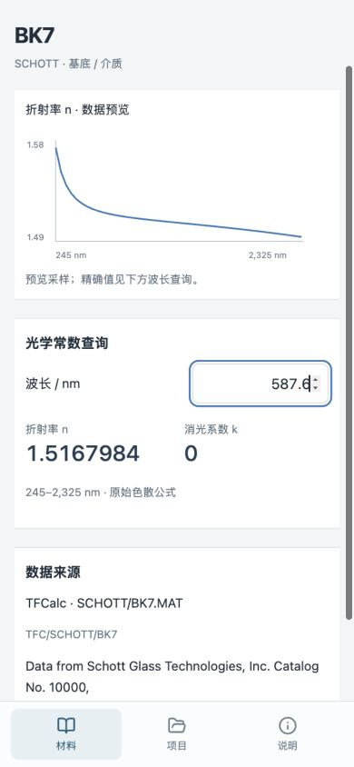
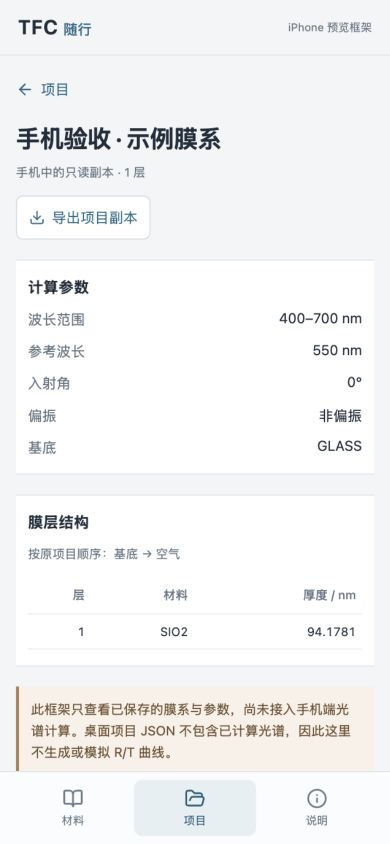

# TFC 随行 · iPhone 查阅框架（预览 0.1）

这是当前桌面项目中的独立移动查阅入口，不是已签名的 iOS 原生 App。桌面产品仍为 0.2.2 开发验证版，本次不发布正式版本标签，不改生产计算引擎。

## 已实现

- iPhone 单列触摸界面，底部材料、项目、说明三个入口；输入框 16px，常用操作触摸高度至少 44px，支持安全区域。
- 直接复用 `engine/data/tfcalc-catalogue.json`，全部 1,211 条记录进入构建产物，不另做简化数据库。默认显示 1,186 条可用记录，25 条异常记录可筛选查看，禁止数值查询。
- MATERIAL 372 / SUBSTRAT 417 / SCHOTT 201 / SOPRA 221，按来源及状态筛选，名称、牌号、备注多关键词搜索，40 行分页。
- 材料详情含原始色散公式、完整原始 n/k 表格、来源、校验值、有效波长范围和折射率预览。波长查询复用桌面 `materialAt`，表格线性插值、公式按原系数计算；禁止范围外查询，不改变桌面既有函数行为。图表颜色来自移动主题 `--curve-n`。
- 桌面“文件 → 导出项目”生成的 `.tfc.json` 可在手机文件选择器导入。项目只读查看膜层、参数及材料名称，以原始精度保存、原样 JSON 导出。重复 ID 拒绝覆盖，需先保留副本再移除旧项。
- IndexedDB 独立本机存储，不读写桌面 Workspace，不上传项目，不自动同步。
- Service Worker 完整预缓存界面、图标和材料数据；下载全部成功后才显示就绪。更新保留前一份缓存，避免旧页面引用的资源提前被删除；同源静态资源忽略服务器 `Vary: Origin` 差异，防止离线模块加载失败。
- 沿用桌面光学图标：512px 网页应用图标、180px Apple 主屏幕图标、网页 favicon、独立运行 manifest。

## 预览与安装

开发环境：`npm run mobile:dev`，访问 `http://localhost:1421/mobile.html`。移动界面不经过桌面 Python 开发桥。

构建：`npm run mobile:build`，然后 `node scripts/check_mobile_build.mjs`。独立产物在 `dist/mobile/`。`npm run mobile:preview` 在 1421 端口预览此产物。

手机与电脑连接同一可信 Wi-Fi 后，Safari 访问预览服务打印的 Network 地址，路径补 `/mobile.html`。局域网普通 HTTP 只适合联网查看，不能承诺主屏幕离线使用；电脑关闭后此 HTTP 地址不可用。此服务绑定局域网，仅提供移动静态产物，不暴露 Workspace 或计算服务。

长期随身使用需要将 `dist/mobile/` 整个目录部署到可信的 HTTPS 静态站点，可放在站点子目录；本次没有创建公开站点，也没有上传用户项目。手机 Safari 打开该 HTTPS 地址，进入“说明”，确认“材料库与界面已准备离线使用”，再选择分享 → 添加到主屏幕。新增图标会使用当前 TFC 光学标识。初次下载后可关闭网络验证。

Apple 官方：[将网站作为 iPhone 网页应用打开](https://support.apple.com/guide/iphone/open-as-web-app-iphea86e5236/ios)。Service Worker 的 HTTPS 要求见 [MDN](https://developer.mozilla.org/en-US/docs/Web/API/Service_Worker_API/Using_Service_Workers)。

## 项目怎么带到手机

1. 电脑打开项目，保存后使用“文件 → 导出”导出项目 JSON；也可以选择 Workspace/projects 中的 `.tfc.json` 恢复副本，注意它只代表上次保存状态。
2. 通过 AirDrop、iCloud Drive 或其它自选方式传到手机。
3. 手机随行界面进入“项目”，选择“从文件导入项目 JSON”。
4. 导入项目以只读副本保存在此站点的浏览器存储，不会覆盖电脑原件。清理浏览器数据、更换站点地址或系统回收存储，可能导致手机副本不可用，请保留原件。

未把用户 621 个项目预装到程序或 GitHub。可以自行按需导入，不依赖原 TFCalc 软件。

## 架构与后续边界

`mobile.html → src/mobile/main.tsx → 现有材料目录 + materialAt / matchesMaterial`。

项目通过独立的 `src/mobile/data.ts` 验证、保存与读取，移动样式单独隔离。`vite.mobile.config.ts` 输出独立静态产物；桌面 `src/main.tsx`、窗口 IPC、Python、SQLite、材料原始目录均未修改。构建包不含 Python / NumPy / Plotly 或用户膜系。CI 构建并检查移动框架，单独保存预览 artifact，不混入桌面正式 Release。

尚未实现手机光谱计算、项目编辑、TFD 直接解析、Workspace/SQLite 文件夹访问、云同步、IPA 签名、TestFlight 和 App Store 发布。桌面项目 JSON 不含已计算光谱，手机不伪造 R/T 图。未来可单独增加真实光谱快照导入，再评估原生宿主及经过对照验证的移动计算方式。

## 本机验证（2026-11-04）

- 桌面生产构建、独立手机构建通过；52 项计算引擎 Python、33 项 TypeScript（新增 3 项手机文件验证）、7 项打包/迁入 Python 测试通过。
- 构建检查验证 1,211 个材料标识都进入静态资源、图标和预缓存文件存在、不依赖桌面计算桥；模拟无网络缓存读取及旧缓存保留通过。
- 对已有 621 个迁入项目的 JSON 做只读导入验证，621 通过、0 失败，没有改写原件。
- Mac 内置浏览器检查：390px 宽无横向溢出；BK7 多来源搜索；587.6nm 查询 n=1.5167984；范围外不返回伪数值；合成项目导入、本机持久保存，刷新后重开成功。
- 关闭本地预览服务器后，重新加载、搜索、材料详情与已保存项目读取成功。
- 截图仅含内置材料与合成示例，不含用户实验膜系。
- 尚未完成 iPhone 真机 Safari 主屏幕安装、飞行模式、文件导出落盘及系统存储回收验证。内置浏览器下载事件未返回，不能将导出功能的真机落盘验收记为通过。HTTPS 部署后需要补这些检查。

## 离线及 iPhone 协同验收

后续新增设备模式显示、前台缓存完整性检查、8 秒超时与部署路径缓存隔离；用户第一轮 iPhone 检查反馈异常，尚未通过真机验收。Mac Safari 的实际停止服务器重载与材料查询已通过。逐项结果和待测项见 [离线与真机验收记录](iPhone离线与真机验收.md)。
