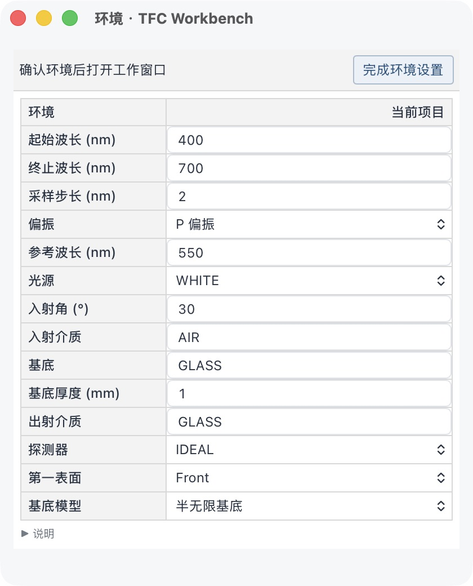
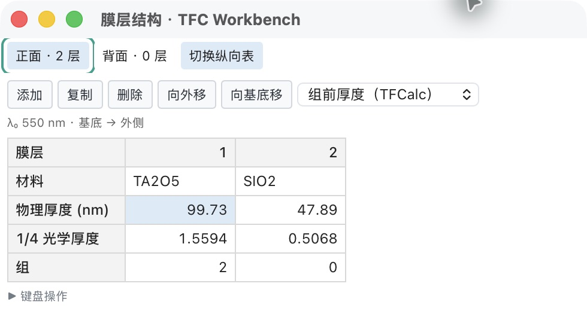

# 启动打开文件流程预览

2026-11-09。未编号预览，产品版本仍为 0.2.5-dev.2，未替换正式包。

## 当前交互

1. 桌面启动时光谱主窗从原生层即为隐藏，不闪现参考膜系；菜单就绪后自动弹出系统“打开项目”窗口。
2. 选择 TFD 或已有 JSON 项目后，仅显示环境窗口。
3. 点击“完成环境设置”，按窗口配置打开工作窗口。默认是光谱和前表面膜层；保留用户之前配置的选择。
4. 取消启动文件选择后，没有工作窗口，Mac 仅保留系统菜单，Windows 仅保留独立菜单小窗口。
5. 在菜单“文件 → 新建项目”建立零膜层新项目，先确认环境，再进入工作窗口。
6. 未打开项目时不计算内置示例，也禁止保存、另存、导出、膜层和分析命令；新建、打开、窗口配置、帮助及退出仍可用。
7. 打开失败会给出错误提示，旧项目不被替换；关闭启动错误提示可回到菜单模式。

浏览器受文件选择安全机制限制，启动显示紧凑的打开项目对话框，用户点击“选择文件”触发浏览器文件选择。取消后显示菜单与空白工作区，不虚构可操作的参考项目。

## 验证范围

本机编译通过；65 项 TypeScript 检查通过，其中新增无项目菜单状态验证。桌面实际启动观察到原生打开窗口；取消后菜单仍可新建，新建先显示环境。最终桌面构建实际选择 TFD 后显示环境，完成后显示前表面膜层；浏览器已验证取消后仅菜单、从菜单新建，以及先前查看背面后新建会恢复前表面。13 项 Rust 检查、原生菜单和 17 个窗口 IPC 回归通过。证据见 startup-native-menu.json / startup-window-ipc.json。计算引擎、TFD 写出格式和用户原工作区未修改。

上一项 TFD / 窗口流程代码的 [双平台流水线 42498655881](https://github.com/LiuYiMing007/tfc-workbench/actions/runs/42498655881)已全部通过；它不能代替本次启动流程在 Windows 上的交互实测。

