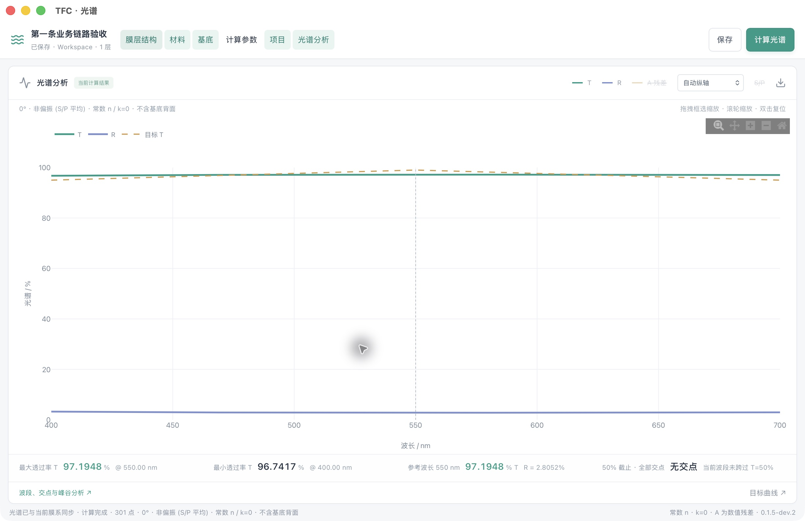
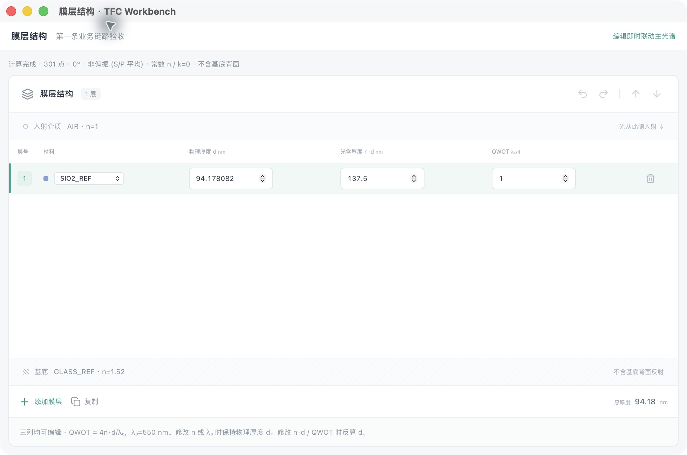
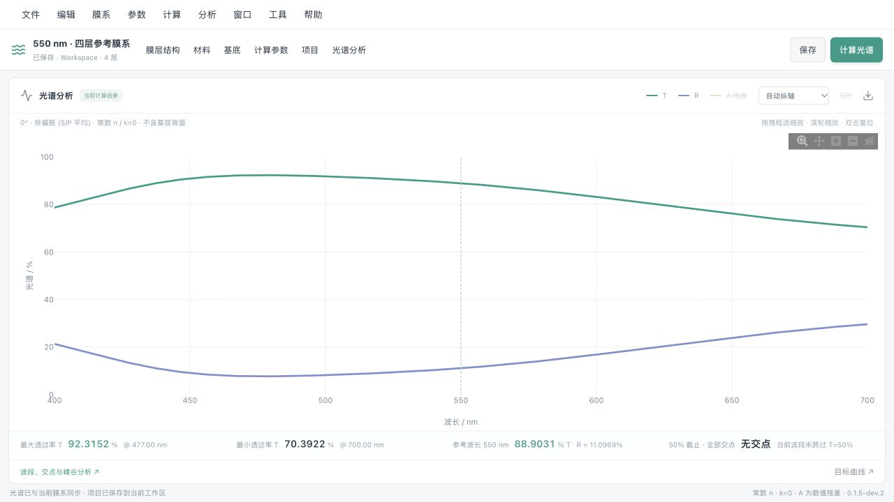

# TFC 0.1.5 更新报告

日期：2026-11-02。版本：**0.1.5**。用户已授权将三个代表窗口的改造同时用于 macOS / Windows 并发布正式版；本次不扩大其他窗口的视觉改造范围。后续缺陷修复使用 0.1.6 等版本。

## 0.1.5 修订2：Windows 窗口打不开修复

用户报告 Windows 点击工具窗口后没有反应，随后菜单也无法操作。定位到工具窗口由同步 Tauri IPC 命令创建，命中 WebView2 在同步回调中创建窗口可能死锁的[已知限制](https://docs.rs/tauri/latest/tauri/webview/struct.WebviewWindowBuilder.html)。修复为异步命令，并用异步锁串行处理重复打开请求；沿用真实独立窗口和同一个项目状态，不修改计算核心或文件格式。

旧验收直接从 Rust 创建窗口，绕过实际前端 IPC，未覆盖此故障。新增 `--window-ipc-self-test`：加载发布包内真实前端，使用生产 `useToolHost`、`useDesktopMenus` 和工具窗口 React 界面；由按钮路径和菜单事件路径依次打开全部七个工具，确认共享项目已渲染，再验证关闭隐藏及重新打开。此模式不挂载实际 App、不调用引擎、不创建或更改用户 Workspace，正常运行不可调用测试专用命令。检查加入双平台 CI，超时/死锁视为失败。它仍不等同于物理鼠标点击 Windows 原生菜单或显示缩放验收。

按用户最新明确要求，本次覆盖同版本 0.1.5 下载包，界面标识“修订2”；旧包与源码先存档，原标签已以受旧值保护的方式更新到修复源码，不修改其它版本。覆盖是本次特许，不作为今后默认版本政策。新增 `TFC-0.1.5-macOS-Windows-portable.zip` 合并包及 SHA-256，包含同一项目根目录下的 macOS、Windows 程序，仍不附带个人工作区。

合并打包器验证两个输入包 SHA-256、路径安全及共同项目标识，拒绝夹带 Workspace、冲突文件和损坏包。增加四项打包回归测试。[最终双平台验收 41469747170](https://github.com/LiuYiMing007/tfc-workbench/actions/runs/41469747170) 全部成功；两端各 32 项引擎 Python、22 项 TypeScript、4 项打包 Python、25 项数值检查通过，Rust 为 Mac 10 / Windows 9 项。两端真实前端 IPC 检查确认七个工具窗口分别从按钮、菜单命令路径打开，共享项目渲染、关闭隐藏与重新打开全部通过，测试未使用工作区。[修订替换发布 41472087880](https://github.com/LiuYiMing007/tfc-workbench/actions/runs/41472087880) 成功，已替换旧四个资产并新增合并 ZIP 与校验文件，共六个资产；发布页所有摘要核对通过。

程序来源为 `0e0f47c1813f6431940f6ff3b4690a8edc663da9`。本机 `release/0.1.5-revision2/TFC/` 已解压合并正式包，通过发布摘要、Mac 严格签名、Windows PE x64 / 版本、共同根目录定位检查；不预放个人 Workspace，原工作区未覆盖。旧包备份在本机 `backups/releases/0.1.5-original-718339b/`，旧源码为远程标签 `archive/0.1.5-before-windows-window-fix`。详细来源与摘要见 [修订2发布记录](../v0.1.5-revision2-release-provenance.json)。

推荐下载 `TFC-0.1.5-macOS-Windows-portable.zip`。完全退出旧程序（卡住时先结束 TFC.exe），仅替换 macOS、Windows 程序子目录，保留 Workspace、Workspaces、.tfc 和项目标识。启动后应显示“0.1.5 · 修订2”。本次实测覆盖自动化真实前端通信与工具渲染，仍不代表 Windows 物理鼠标原生菜单点击和显示缩放的人工验收。

## 正式版变化

- macOS 原生系统菜单；Windows 独立菜单小窗口，属于同一应用并控制同一项目。
- 主光谱窗口与真正的独立工具窗口；关闭工具只隐藏，支持位置记忆，项目、撤销、计算和保存由主工作台统一管理。
- 光谱为主视觉中心，T/R/A 及 S/P 采用统一 Chart Theme，结果与状态使用紧凑信息栏。
- 膜层表格支持双击/F2、直接键入、Enter/Tab 提交移动、Esc 取消、方向键选格、Shift 选区、Ctrl/Cmd+C/V、Z/Y/Shift+Z。多格粘贴整批校验，一次撤销；显示精度不写回数据。
- 计算参数采用对齐属性面板；有效提交后自动重算，保持已有仅采用最新结果的计算队列。
- 保留 Optical Core、材料常数、项目结构、文件格式和 Workspace 便携路径。无 AI Agent、优化、公差分析等新增计算功能。

## 验证和发布范围

代表窗口源码 d01d822 已在[双平台运行 41317275458](https://github.com/LiuYiMing007/tfc-workbench/actions/runs/41317275458) 全部通过：两端各 32 项 Python、22 项 TypeScript、25 项数值检查；Rust 为 Mac 10 / Windows 9 项。Windows 的独立菜单/工具窗口创建、隐藏恢复、主窗无重复菜单、单次命令路由、只读投影与权限隔离检查通过；打包引擎保存/搬迁/精确复算与实际客户端相对路径定位检查通过。源码及交互证据见下方开发记录与工程界面规范。

正式版同步 package / npm lock / Tauri / Cargo / Cargo lock 五处版本；macOS 打包流程增加整包临时签名及严格签名校验，随后使用签名后的同一包进行原生和便携验收。v0.1.5 标签的工作流必须在 macOS、Windows 的全部检查成功后才能创建 Release，发行文件仅包含程序包与 SHA-256 校验文件，不包含个人 Workspace。

Mac 原生编辑和浏览器兼容已实测。**Windows 自动构建和原生集成检查不代表人工视觉验收**：Windows 显示缩放、物理键盘、多显示器和物理 SSD 往返仍未实测。Mac 无 Developer ID 公证，Windows 无商业代码签名证书。

## 正式发布验收结果

[正式标签构建 41456821637](https://github.com/LiuYiMing007/tfc-workbench/actions/runs/41456821637) 的 macOS、Windows 与 Release 任务全部成功，程序来源为 `718339b54766e0c6fc09cb9df53009de0a335961`。Windows 正式包包含原生独立菜单、主光谱及工具窗口，共享同一项目；两端完成全部测试、原生隔离、打包引擎搬迁精确复算及实际客户端相对定位检查。正式发布仅包括两个 ZIP 与各自 SHA-256，不含 Workspace。

最终 CI 报告已归档为 `v0.1.5-macos-ci-*-check.json` 与 `v0.1.5-windows-ci-*-check.json`。正式标签保持不变，发布后证据以仅文档提交补充。 两个包已下载并与发布页摘要、SHA-256 文件核对一致，Windows PE x64 / 0.1.5 版本验证通过，Mac 严格签名复核通过。下载来源与校验值见 [发布来源记录](../v0.1.5-release-provenance.json)。本机 `release/0.1.5/TFC/` 已合并双平台程序，根目录相对定位验证通过；目录不预放个人 Workspace，原便携项目保留。

## 下载与升级

[GitHub v0.1.5](https://github.com/LiuYiMing007/tfc-workbench/releases/tag/v0.1.5) 提供 macOS arm64 与 Windows x64 ZIP，各带 SHA-256。Windows 必须保留整个 Windows 目录，包括 engine；Mac 保留整个 TFC.app。

关闭 TFC 并备份工作区后，只替换项目根目录的 macOS / Windows 程序子目录，保留原 Workspace、Workspaces、.tfc 和 tfc-project.json。两端使用同一个根目录时读取同一份数据，不能在两台设备同时写入。材料等其他窗口本次保持旧样式。

---

以下保留开发阶段记录，开发版路径、版本号及“尚未发布”等描述仅代表当时状态。

## 第一项：跨平台菜单

Mac 增加系统原生菜单；Windows 增加独立的小型原生菜单窗口，主工作区布局和常用按钮保留。菜单覆盖文件、编辑、膜系、参数、计算、分析、视图、工具、帮助，共用同一命令目录与现有执行函数。Windows 菜单窗口和主工作台属于同一应用，不持有第二套项目或计算状态。

新增面板显示/隐藏与恢复布局、参数定位、快捷键说明；实现菜单状态同步、菜单窗口收起/恢复和退出保护。dev.1 当时未开发的另存为、批量编辑、优化及公差分析置灰；dev.2 已连接项目另存为。Optical Core、材料/膜系数据结构、保存和可迁移 Workspace 机制保留。

具体结构、快捷键和验收语义见 [菜单设计](../0.1.5-跨平台菜单设计.md)。正式 0.1.5 尚需后续界面/光谱曲线需求及整体验收。

## 修改范围

- src/menus/：共用菜单目录、命令门控、状态发布、Windows 菜单窗口内容及浏览器菜单。
- src-tauri/src/menus.rs、menu_check.rs、main.rs：系统菜单、独立窗口、定向命令与权限、原生隔离验收入口和生命周期。
- src-tauri/capabilities/menu.json：辅助窗口最小事件权限。
- src/App.tsx、LayerEditor.tsx、layerCommands.ts、SpectrumPanel.tsx、spectrumExport.ts、main.tsx、styles.css：复用现有操作、面板显示和入口。
- tests/menus.test.ts、scripts/validate_menu_release.py、CI：菜单状态、快捷键、共用膜层逻辑及原生窗口验收。
- package、Tauri/Cargo 版本：一致标为 0.1.5-dev.1。

## 验证记录

本机 32 项 Python、9 项 TypeScript、8 项 Rust 及 25 项数值检查通过，Mac 原生隔离验收通过。实际 Mac 系统菜单保存、添加/撤销膜层、导入验证样例并计算 121 点、隐藏/恢复设置、参数聚焦、未保存退出确认/取消及保存后退出通过。证据见 v0.1.5-dev.1-darwin-menu-check.json 与 v0.1.5-dev.1-mac-ui-check.json。

浏览器在隔离 Workspace 下实测菜单展开、添加膜层、撤销和光谱有效状态恢复通过；Mac 浏览器快捷键说明与实际命令一致（单独修正了显示文字，本机生产前端构建通过）。证据见 v0.1.5-dev.1-browser-check.json 及对应截图。

[双平台运行 41262492504](https://github.com/LiuYiMing007/tfc-workbench/actions/runs/41262492504) 已成功：Mac/Windows 构建、32 项 Python、9 项 TypeScript、25 项数值、Mac 8/Windows 7 项 Rust，以及原生菜单、工作区保存/搬迁/复算检查全部通过。Windows 原生独立窗口的收起/恢复、主窗无重复菜单、禁用命令、勾选同步、单次定向命令与辅助窗口权限检查通过，Workspace/.tfc 未变。证据见 v0.1.5-dev.1-windows-ci-menu-check.json 和 macos-ci-menu-check.json。

原生在线构建来源为 b0f497d；随后提交 9e605d1 仅修正浏览器中的 Mac 快捷键显示文字并附实测记录，本机已重新构建前端及 Mac 开发程序。Windows 的视觉摆放、手工点击体验仍需真实设备检查，不能以自动检查代替人工验收。

本机 `release/0.1.5-dev.1/TFC/` 已包含双平台程序及项目根标识，不附带个人数据或点击测试工作区。旧正式版 `便携项目/TFC` 仍为 0.1.4；不要用空开发版工作区覆盖它。不包含 AI Agent、膜系优化或新的专业计算任务。

## 第二项：光谱主窗口与真正的工具窗口（dev.2）

主窗口改为大面积可伸缩光谱、紧凑指标栏及状态栏；膜层、材料、基底、计算参数、项目、分析和目标曲线拆成真实 Tauri 工具窗口。关闭工具只隐藏，菜单可再次打开。默认只启动主光谱；可选择下次恢复已打开的工具，位置和尺寸按系统保存在项目内 `.tfc/window-layout.json`，换显示器时回到可见区域。

所有窗口共用主窗口的唯一项目状态、保存逻辑与计算队列。工具通过字段旧值校验及膜层稳定 ID 提交命令，避免整份项目相互覆盖；连续输入合并为最新计算，旧结果不能回写。增加材料搜索、常数材料 JSON 导入、项目另存为和共享操作提示。浏览器开发模式保留会话内浮动工具，桌面优先使用真正窗口。

新增 `src/tools/`、`src/TextInput.tsx`、`src/calculationQueue.ts`、`src-tauri/src/tools.rs`、工具权限及 `tests/tools.test.ts`；调整 App、绘图、参数、材料、数值输入与样式；扩展原生窗口隔离测试及脚本。package / lock / Tauri / Cargo 版本一致为 0.1.5-dev.2。设计与状态协议见 [多窗口设计](../0.1.5-多窗口工作台设计.md)。

本机 32 项 Python、17 项 TypeScript、10 项 Rust 测试及 25 项数值检查通过。Mac 实际编辑膜厚 105 nm、入射角 30°、S 偏振时光谱自动变化，工具关闭不丢数据；原生创建/隐藏/恢复、命令单次路由、权限和投影顺序隔离检查通过。最终 Mac 界面、保存重开及精确复算已通过，见 v0.1.5-dev.2-mac-ui-check.json、mac-spectrum-roundtrip.json、mac-spectrum.png、mac-layers.png；浏览器记录见 browser-check.json 与 browser-spectrum.png。本节不代表 Windows 人工视觉验收。

当前仍为开发构建，不覆盖 0.1.4 正式便携项目，不创建正式 0.1.5 标签。未新增计算模型、AI Agent、膜系优化或公差分析。

补充：原生菜单命令不抢当前工具焦点；恢复布局后自动加载共享项目/材料列表；连续修改材料或波段的不同字段保留先前编辑。桌面 JSON 桥启用 float_roundtrip，并以已复现的舍入样本做位级检查，避免保存光谱时改变浮点尾数；光学公式未变。

### dev.2 本机最终验收

新建项目 → 添加膜层 → 切换为 SIO2_REF → QWOT=1（d=94.17808219178083 nm）→ 自动 R/T 光谱 → 保存 → 重新打开通过。独立分析窗口的 450–650 nm 通带均值为 97.15303588334429%，目标窗口导入 3 点 CSV 后主光谱显示目标 T，保存及重开均保留。带分析/目标的数据也完成桌面保存与逐字段精确复算。

最终源码为 3213e99；对比原有 1d70750，engine 与 fixtures 未改。32 项 Python、17 项 TypeScript、本机 10 项 Rust、25 项数值检查及程序定位/搬迁/精确复算通过。快速连续输入项目名称已实测保存完整。文本输入和数值输入只保留输入框草稿，不持有另一份项目。

程序测试目录为 `release/0.1.5-dev.2-verified/TFC/`，与原 `便携项目/TFC` 和较早试用目录分开，不附个人数据。测试数据留在 acceptance；当前运行的其他应用及用户工作区保留。

### dev.2 双平台完成结果

[最终双平台运行 41271255666](https://github.com/LiuYiMing007/tfc-workbench/actions/runs/41271255666) 已成功，程序来源为 3213e99。两种系统各完成 32 项 Python、17 项 TypeScript、25 项数值检查；Rust 为 Mac 10 / Windows 9 项。两边均通过桌面构建、原生菜单与工具窗口隔离、打包引擎保存/搬迁/精确复算、实际客户端相对路径定位和便携目录检查。

Windows 自动验收确认独立菜单窗口及工具窗口可关闭隐藏/重开、主窗不重复菜单、命令只路由一次、旧投影不覆盖新状态、工具不能调用主端存储/计算，Workspace 与 .tfc 不变。证据为 windows-ci-menu-check.json、windows-ci-portable-check.json；Mac 对应文件同名使用 macos 前缀。构建及校验信息见 v0.1.5-dev.2-release-provenance.json。

`release/0.1.5-dev.2-verified/TFC/` 已合入 Windows 便携程序并校验下载包 SHA-256，包含 macOS 与 Windows 两套程序及共同项目根标识，不包含任何个人 Workspace。试用前先保存并退出其它 TFC 版本，再打开此目录中的 macOS/TFC.app 或 Windows/TFC.exe。目录首次启动会创建独立 Workspace。原正式版及较早试用目录保留。

Windows 真机的窗口摆放、显示缩放和人工快捷键体验，以及多台实体显示器/物理 SSD 往返仍未实测。没有发布正式 0.1.5 标签或 Release；本次只完成已提出的前两项界面要求，后续光谱交互细节仍可继续在开发版调整。

本机 Mac 测试包补做本地 ad-hoc 整包签名，并通过严格递归封装验证及原生窗口检查；签名只改变封装信息，源码及计算内容不变。程序来源和签名前后校验值在 provenance 中记录；未做 Apple Developer ID 签名或公证。

## 第三项：三个代表窗口预览（0.1.5-dev.3）

本阶段仅完成光谱主窗口、膜层结构与计算参数的现代工程界面，不自动推广到其他窗口。计算核心、材料常数、项目结构和文件格式未改；正式便携项目及个人 Workspace 未覆盖。无 AI Agent、优化等新计算功能。

- 光谱：移除重复标题、彩色结果标签、说明行与底部工具行；主窗保留紧凑命令和曲线工具栏、结果栏、状态栏，其余空间交给图表。T/R/A 与 S/P、目标曲线共享语义 Chart Theme；measured/comparison 只预留样式角色。
- 膜层：29px 表格行、固定表头、右对齐数值；选择态与编辑态分开。F2/双击/直接输入、Enter/Tab 移动、Esc 取消、方向键与 Shift 选区、Ctrl/Cmd+C/V、Z/Y/Shift+Z；多格 TSV 整批校验、一次提交和撤销。显示最多六位小数，编辑和复制保留完整数值。结构操作复用现有命令，集中在工具栏和右键菜单。撤销后恢复焦点；新增/移动膜层同步选格。
- 参数：三列属性布局、分组和单位对齐，提交有效输入后沿用原有自动计算队列。保留编辑草稿，不逐字写项目历史。默认高度 560px，已有用户布局不覆盖。

新增 `src/design/chartTheme.ts`、`engineering.css`、`CommitNumber.tsx`、`layerGrid.ts` 和对应测试。调整 App 主窗、SpectrumPanel/Chart、LayerEditor、CalculationSettings、工具焦点连接与浏览器代表窗口样式入口；五处版本清单同步为 dev.3。规范见 `docs/0.1.5-工程界面规范.md`。

本机检查：32 项 Python、22 项 TypeScript、10 项 Rust、25 项数值检查通过；前端与 macOS 桌面构建成功。原生菜单/工具窗口创建、隐藏恢复、单次命令路由、权限和投影顺序检查通过。打包引擎在独立临时工作区完成保存、搬迁和 121 点精确复算。核心和 Golden 文件无修改。

实机与浏览器检查包括：厚度提交联动、F2、Enter/Tab、直接输入不丢首位、撤销后保留焦点并继续重做、两行粘贴一次撤销、复制原始精度、无效粘贴不部分修改、入射角 30° 联动及 Esc 取消、工具关闭隐藏。截图及记录见 `v0.1.5-dev.3-*`。

本地试用：`release/0.1.5-dev.3-preview/TFC/macOS/TFC.app`，独立目录、首次运行创建自己的 Workspace，未夹带用户数据。本机临时签名验证通过，无 Developer ID 公证。Windows 本次人工视觉与键盘体验尚未验收；GitHub 双平台构建状态以 Actions 实际结果为准。未创建正式 0.1.5 标签或 Release。等待用户确认三个窗口后再决定是否推广。
