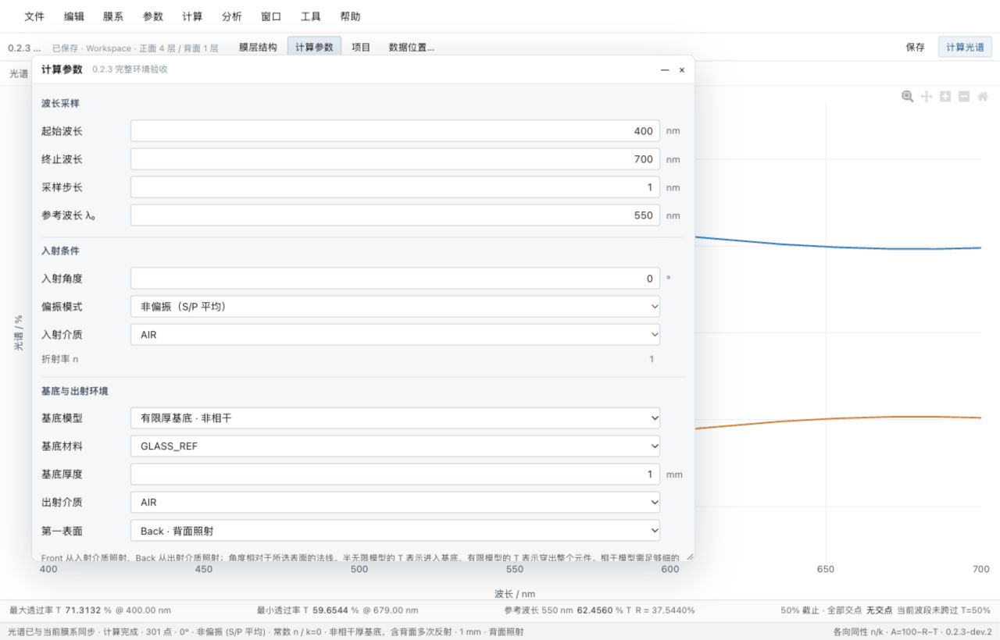
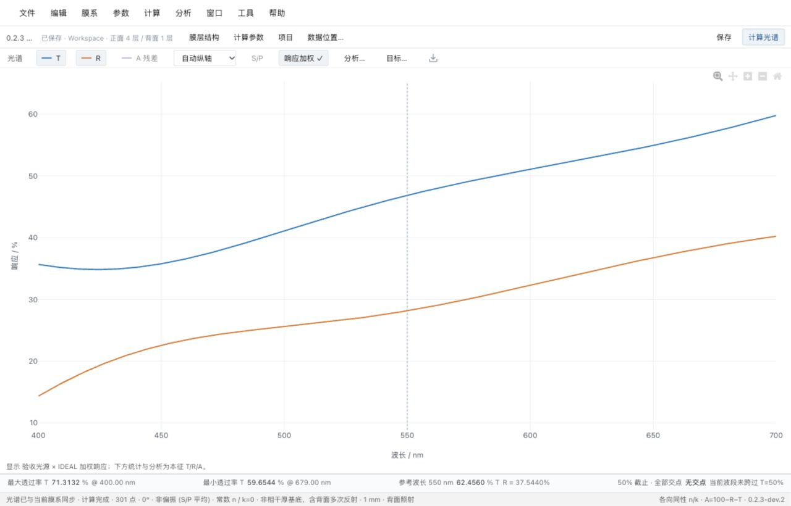

# 0.2.3 更新报告

当前验证版本为 **0.2.3-dev.3**，尚未创建0.2.3正式标签或Release。完整光学环境、命名文件、分组与TFC式交互式分析已实现；最新源码 `12409e8cb8b8c5dc4532d1ee43590ec1f2e09427` 的Mac本机程序与[Windows实际运行作业](https://github.com/LiuYiMing007/tfc-workbench/actions/runs/42240591525/job/127969530192)均通过验收。Mac使用同源码本地构建；不冒称排队中的macOS CI已通过。旧dev.2证据继续保留，最终dev.3范围及布局见第八、九节。

## 一、完整光学环境

计算参数提供参考波长、入射角、入射介质、基底、基底厚度 mm、独立出射介质、光源、探测器及 Front/Back 第一表面。

- 保留既有单面半无限计算；新增有限厚非相干基底和相干基底。
- 非相干模型包含正反面膜系、基底吸收及背面多次反射；相干模型保留基底干涉。
- 膜层窗口分别编辑正面和背面，两侧均从基底向外编号；背面也支持 d、n·d、QWOT、键盘编辑和共享撤销。
- Front/Back 正确改变实际入射侧、膜层顺序及介质；外侧角通过切向波矢传递到内部。
- WHITE/IDEAL 是平坦参考；可输入自定义光源强度或探测器效率表，随项目保存。加权曲线单独显示，本征 T/R/A、能量检查和分析保持独立。
- TFD 读取基底厚度、出射介质、光源/探测器名称、第一表面、正背膜层及组系数。缺少材料、响应数据、背膜所需的厚度/出射环境或不支持的特殊定义继续明确拦截。

半无限 T 表示进入基底，有限模型 T 表示穿过整片进入出射介质。出射介质等于基底且无背膜不等于磨毛涂黑，也不模拟粗糙度或散射。

[模型、公式和边界说明](../0.2.3-光学环境与有限基底设计.md)

## 二、命名保存与逐项文件

首次保存弹出命名窗口；另存为建立独立项目，保留原项目；普通保存更新当前项目。中文文件名可读，同名自动编号，内部 ID 保持关联。项目列表及保存结果显示实际相对路径。

| 相对于 Workspace 的位置 | 内容 |
|---|---|
| `projects/<名称>.tfc.json` | 环境、正背膜层、所用材料及响应数据的项目快照 |
| `materials/catalogue/<来源>/*.material.json` | 原始膜层材料逐项文件 |
| `materials/substrates/<来源>/*.material.json` | 原始基底、介质逐项文件 |
| `materials/custom/*.material.json` | 自定义膜层材料 |
| `materials/substrates/custom/*.material.json` | 自定义基底、介质 |
| `materials/builtins/`、`materials/substrates/builtins/` | 内置参考材料逐项文件 |
| `materials/catalogue/individual-files-v1.json` | 1211 条原始记录与相对文件路径索引 |
| `spectra/<项目名称及短标识>/光谱-<UTC时间>.spectrum.json` | 与输入对应的光谱快照 |
| `database/workspace.sqlite3` | 项目、共享库与光谱索引主数据库 |

原始合集仍保留。原始材料文件使用可读名称及短来源标识区分同名数据。文件可以独立携带和导入；外部编辑后通过“导入 JSON”校验，再保存到共享库，不监控外部改动自动覆盖数据库。修改原始库时建立用户副本，历史项目的材料快照不随共享库更新而改变。

## 三、交互式分析

分析 → 交互式分析，或窗口 → 交互式分析。桌面使用真实工具窗口，与主窗口共用 Project State 和计算队列。

支持正面/背面单层物理厚度、QWOT、正背整体厚度系数及入射角。提供数值输入、步长、加减、滑块、恢复原值及开始下一轮；一轮连续修改合并为一次撤销。旧计算结果不能覆盖新曲线，其他窗口修改后旧会话不能覆盖新膜系。

尚未实现原 TFCalc 全部交互变量、监控/电场分析、曲线历史叠加或自动优化；本次没有开发 AI Agent 或优化器。

## 四、兼容性与数据保护

普通旧项目继续读取格式 v1。使用有限基底、Back 照射、背膜或自定义响应的项目保存为格式 v2，使旧客户端拒绝不认识的物理模型，避免静默算成半无限基底。新客户端兼容 v1/v2；Workspace 清单仍为 v1、跨平台相对引用不变。

Mac 和 Windows 需要同时使用支持新环境的客户端。旧 iPhone 查看框架只支持项目 v1，本次未宣称完成手机端新格式验收。

未覆盖用户原 Workspace；所有计算/迁入验收使用隔离副本。程序打包不包含用户膜系、SQLite、工作区或实验原件。

## 五、已完成验证

- 64 项 Python 引擎/存储测试、50 项 TypeScript、8 项打包/迁入测试、Mac 12 项 / Windows 11 项 Rust 通过。
- 25 项既有数值检查通过，原 Golden 最大误差仍为 `7.838345368327282e-7` 个百分点，原始 Golden 和材料光学常数未改动。
- 新模型包含玻璃片解析算例、多角度 S/P、吸收薄膜及基底、前后涂层、反向照射、相干/非相干、临界角、全反射、不透明基底、响应分离及新格式保护的独立检查。
- Mac 冻结引擎与独立 TMM 最大差异 `6.288303211476887e-13` 个百分点；中文命名、1211 条材料逐项文件、保存/搬迁/精确复算通过。
- Mac 8 个真实工具窗口的打开、菜单、关闭重开及共享状态通过；新增环境控件、背膜添加和调膜按钮的实际 React → Tauri IPC → 主状态联动通过。
- 本地预览实际完成背膜 60→70 nm 键盘编辑、Back 照射、自定义光源及命名保存，磁盘项目格式 v2、背层和响应数据均正确写入。
- dev.2 阶段原始 771 个 TFD 中 767 个导入/计算/保存/精确复算，4 个材料问题仍拦截；621 个保持项目 v1、146 个使用 v2。共检查 537707 个光谱点，最大能量残差 `8.060219158778636e-14`（0–1 比例）。812 个原始归档条目逐项哈希一致。

- Windows 同一源码实际完成全部测试、原数值回归、桌面程序构建及 8 份运行验收：菜单、多窗口、内置材料、TFD、新环境、保存工作区、文件夹入口、便携搬迁。8 个真实工具窗口均可打开/关闭重开；环境、背膜和交互调膜共享状态通过。
- Windows 资源管理器实际核对 8 个目录目标；材料/基底逐项文件、命名项目、光谱及数据库可见。
- 两端 4 种环境 × R/T/S/P 共 24 个参考数值最大差异 `7.105427357601002e-14` 个百分点；各自冻结引擎对独立算法最大差异 `6.288303211476887e-13` 个百分点。
- 如实保留此前 Windows 整轮窗口验收的超时记录；增加逐窗口诊断和总检查时限后，本轮在 35 秒内完成，不能由此断言此前超时的唯一原因。业务状态断言全部保留，未跳过失败窗口。

这些是解析、独立算法、程序运行及内部往返验证；不等同于逐个膜系与原 TFCalc 软件输出对照，也不包含用户实体 SSD 换盘符、物理断网、双显示器或缩放人工验收。

## 六、dev.2历史验收证据与主要文件

[原始膜系汇总](../v0.2.3-dev.2-tfd-aggregate.json)、[Mac 窗口联动](../v0.2.3-dev.2-darwin-window-ipc-check.json)、[Mac 冻结环境计算](../v0.2.3-dev.2-darwin-environment.json)、[原计算回归](../v0.2.3-dev.2-darwin-validation.json)。[Windows 实际运行作业](https://github.com/LiuYiMing007/tfc-workbench/actions/runs/42086568416/job/127453154063)、[Windows 窗口联动](../v0.2.3-dev.2-windows-ci-window-ipc.json)、[Windows 数据目录](../v0.2.3-dev.2-windows-ci-workspace-folders.json)、[双平台数值及包校验](../v0.2.3-dev.2-cross-platform.json)。

主要实现：`engine/finite_substrate.py`、`engine/responses.py`、`engine/optics.py`、`engine/models.py`、`engine/importers/tfd.py`；`src/EnvironmentSettings.tsx`、`src/LayerEditor.tsx`、`src/tools/`、`src/InteractiveAnalysis.tsx`、`src/SpectrumChart.tsx`、`src/SpectrumPanel.tsx`；命名文件功能沿用 `engine/file_exports.py`、`engine/repository.py`、`src/SaveProjectDialog.tsx`。新增 `scripts/validate_environment_release.py`，双平台流程执行同样的冻结环境验收。

## 七、dev.2历史本地验收包

`release/0.2.3-development/assets/` 提供 Mac、Windows 及双系统合并便携包，各附 SHA256。合并包保持同一 `TFC` 根目录及 `macOS`、`Windows` 程序子目录；首次启动后在旁边创建 Workspace，包内不含用户数据。开发包合并沿用正式版合并器，仅在本地允许 `-dev.2` 文件名，不变更正式版本发布约束。现有用户升级应只替换程序子目录，保留 Workspace/Workspaces/.tfc；先备份后用副本体验新格式。

## 八、dev.3 后续调整

手动出射环境、常驻计算服务、紧凑实时调膜和组号/组系数详见 [dev.3 说明](../0.2.3-dev.3-实时调膜与分组.md)。上述 dev.2 双平台证据保留，不冒充 dev.3 的平台运行结果。

## 九、TFC 式界面及最终命名

用户要求交互式分析沿用TFC的小窗口组织，已改为变量+编号、原值、新值逐位增减、恢复到原值、完成、显示记录控制。窗口默认420×300，参数记录及其他控件折叠；完成保留调整并收起窗口。原“计算光谱”统一改为“单纯分析”。逐位编辑、精确恢复及连续预览共50项前端测试通过；最新命名布局已通过Mac本机和Windows原生运行检查。

最终开发包：`release/0.2.3-dev.3/assets/`。两平台同源码，24个环境参考值最大差异7.105427357601002e-14个百分点；[最终来源及校验值](../v0.2.3-dev.3-cross-platform.json)、[TFC式界面及操作说明](../0.2.3-dev.3-实时调膜与分组.md)。

## 2026-11-08：dev.4 紧凑数据窗口预览

按用户反馈收紧窗口尺寸，拆开材料列表与数据窗，加入环境、光源、探测器、组及膜堆表达式入口。加入 TFD 原 QWOT / 物理厚度与当前材料数据一致性提示，未反推修改材料。不是正式发布；视觉方向待确认，Windows 当前代码验证状态见[本轮记录](../0.2.3-dev.4-紧凑数据窗口.md)。
