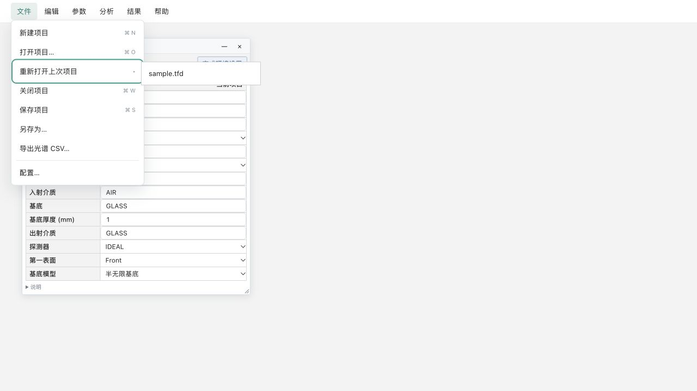

# 0.2.5 更新报告

版本：0.2.5。发布方式：Mac 与 Windows 本地原生构建和验收，Mac 核对回传 Windows 包后合并发布。程序源码为 `7967206`；后续提交只更新文档与验收结果。GitHub 云端构建因账号额度未执行，不作为本版通过依据。

## 功能调整

- 菜单统一为文件、编辑、参数、分析、结果、帮助；移除窗口菜单，将配置移至文件末尾，目标曲线移至分析末尾。
- 结果只有“显示光谱曲线”，恢复同一个光谱窗口及项目状态。
- 文件新增关闭项目：保留实际未保存修改确认，关闭所有工作窗口，仅保留应用菜单；刚打开而未修改的文件不会多余提示保存。
- 打开项目下方提供“重新打开上次项目”右侧子菜单，最近十项按最近使用排序。桌面最近路径是本机缓存，不写入 Workspace；搬迁后可重新选择文件刷新。浏览器最近文件仅在当前会话中保留。
- 光谱工具栏“项目”使用原生打开窗口，默认 Workspace/projects；浏览器保留文件选择兼容方式。
- 膜堆 H/L 支持输入或候选选择完整材料目录，自动读取完整 n/k 数据并加入当前项目。待提交或无效材料不能生成旧材料膜堆。
- 新项目默认使用原库 TA2O5、SIO2、AIR、GLASS。TA2O5_REF/SIO2_REF 是历史数值验证常数，保留旧项目快照和 Golden，不再成为新项目默认材料。
- 修复桌面膜堆窗口缺少材料目录导致打开失败；修复浏览器菜单被工具窗口遮挡、最近项目键盘展开冒泡的问题。
- 最近列表写入失败仅提示，不将已经成功的打开或保存误报为项目失败。

## 保留的先前预览调整

真实 TFD 写出、原生另存为、默认保存到工作区、统一环境、环境先行打开及窗口配置；材料完整逐波数据与统一目录；物理厚度两位小数、QWOT 四位小数及自定义纵轴范围。原版 TFCalc 实机读取仍需单独验证，见 TFD 保存预览说明，不承诺全部扩展数据均能由原版复算。

## 验证

- 75 项 Python、67 项 TypeScript、9 项打包/迁移测试通过；14 项 Rust 测试通过；前端及 Mac 桌面构建通过。
- 25 项数值检查通过，保留原始 Golden；未修改光学计算公式。
- Mac 原生菜单及 17 个工具窗口 IPC 检查通过；冻结引擎项目保存/迁移复算、有限基底、材料目录管理、中文 TFD 导入及工作区目录可见性检查通过。
- 实际界面验证：H 改为 AL2O3 后生成 AL2O3/SIO2 膜层并更新光谱；未修改文件关闭无保存弹窗且所有工作窗口隐藏；最近项目原生子菜单可直接重新打开文件进入环境。
- 本版使用独立验收工作区，不覆盖用户原数据。程序发布包不包含个人 Workspace。

## Windows 本地验收（2026-11-09）

Windows 10 x64 已在关闭流程修复提交 `7967206` 上重新编译，完成 75 Python + 67 TypeScript + 9 打包/迁移 + 13 Rust 测试、25 项数值检查、冻结引擎、Tauri 构建、便携 ZIP 与九类发布校验。新窗口 IPC 的 `all_work_windows_hidden` 和 `reopen_after_hide_all` 均为 true。ZIP 为 `TFC-0.2.5-Windows-x64-portable.zip`，SHA-256 为 `f86b9913baa8eaa6be59691512a6f2cc2a4a1a8829eede9e68b9b09f1a771483`。

真实窗口关闭流程已复验通过：保存确认只保留命名窗，保存后全部工作窗隐藏；取消命名、取消关闭、保存失败均保留项目状态；已保存项目修改后可直接保存关闭；同时打开 materialdata/distribution/rear 后选不保存也一次隐藏全部工作窗。组系数联动、基底新增/编辑/删除/恢复、外部位置另存为通过。物理换盘和显示缩放未覆盖。详见 [Windows 0.2.5 验收记录](../Windows-0.2.5-验收记录.md)。

## 发布包与验证依据

发布三份 ZIP，各附 SHA-256：

- Mac Apple Silicon：`TFC-0.2.5-macOS-arm64.zip`
- Windows x64：`TFC-0.2.5-Windows-x64-portable.zip`
- 双系统共用：`TFC-0.2.5-macOS-Windows-portable.zip`

Windows 回传包 SHA-256 与实机验收记录一致；合并保留两端包全部原始文件内容，不含个人 Workspace/SQLite。合并包 Mac 端已核对签名、实际程序入口定位，完成独立测试项目保存、中文目录搬迁与精确复算。详见 [合并包检查与校验值](../v0.2.5-combined-release-check.json)。

升级时退出程序，只替换 macOS、Windows 程序子目录；保留 Workspace、Workspaces 和 .tfc，勿以空目录覆盖个人数据。

物理 SSD 换盘符、物理断网、125%/150% 显示缩放及原版 TFCalc 实机复算未全面覆盖，不作全兼容或无缺陷承诺；TFD 扩展配置缺少原版等价表达时会要求完整 JSON，避免静默丢失数据。

浏览器菜单与最近项目子菜单实际运行截图：

## Windows 回传缺陷后的共享修复

已调整保存确认顺序、命名期间状态锁定及宿主批量隐藏窗口，并加入全窗口隐藏/再开 IPC 回归检查。Mac、浏览器与 Windows 本地复验均通过。详见 [关闭流程修复](../0.2.5-关闭流程修复.md)。
