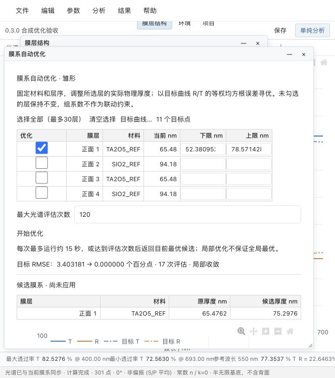
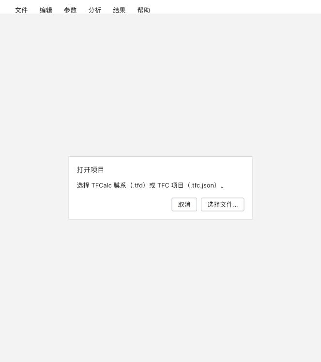

# 0.3.0 更新报告

日期：2026-11-10。本版仅新增两个功能雏形，入口均在“分析”菜单。用户本次明确授权开发膜系优化与 AI Agent；此前暂缓约定不适用于本次范围。

## 1. 膜系自动优化

“分析 → 膜系自动优化…”打开独立窗口。先在目标曲线窗口导入 CSV，再选择需要优化的前/背面膜层，设置每层实际物理厚度上下限和评估次数，运行后查看目标误差、厚度变化和候选光谱，最后应用候选。应用计入现有撤销历史，并触发主光谱重新计算；保存仍使用原有项目保存流程。

- 使用 SciPy 有界最小二乘，调用既有 Optical Core 的同一偏振/有限基底计算路径，不修改光学公式或 Golden。
- 目标为本征 R/T 的等权 RMSE，单位为百分点；各目标通道和采样点等权，不使用光源/探测器响应加权。
- 支持 1–30 个独立膜层、1–500 个目标点；当前膜厚必须在所填上下限内，未勾选的膜层固定。
- 默认最多 120 次真实光谱评估，可设 10–500 次；约 15 秒软时间预算，达到预算返回已评估最优候选。单次光学调用/最终曲线生成不受此软预算中断；桌面任务另有 150 秒硬超时。
- 局部膜厚优化不保证全局最优；不改变材料和层序，暂不做增删层、混合材料、组联动约束或多环境联合优化。

## 2. AI Agent

“分析 → AI Agent…”打开独立窗口。输入 Responses API 服务根地址、模型 ID 和 API Key 后发送任务。默认地址为 OpenAI API；模型 ID 由用户填写，服务需支持 Responses API、函数调用及本版使用的字段。

- 真正的模型工具循环，最多 5 次模型请求、10 次工具调用；提供 `read_project`、`calculate_spectrum`、`propose_thickness` 三个工具。
- 读取当前候选膜层、环境和目标；计算工具调用生产 Optical Core；膜厚修改发生在项目副本中，界面展示候选变化，用户应用后才改变项目。
- 展示本轮工具调用及结果；保留当前窗口的对话，后续发送携带最近 12 条消息；清空对话或清除密钥可直接操作。
- 点击发送会传输当前膜层、环境、目标点、材料名称/模型类型/来源及最近对话；不会自动发送 Workspace、SQLite、实验文件、完整材料 n/k 表或原始 TFD。
- API Key 只保留在窗口内存，通过本地宿主发给所配置的服务，不进入项目、共享快照、日志或版本库。隐藏窗口仍保留内存；清除密钥、切换项目或退出程序可清除。本版不提供密钥持久化。
- 仅允许 HTTPS，回环本机服务可 HTTP；禁止带凭据/查询的服务 URL，拒绝 HTTP 重定向，避免携带密钥跳转。
- Agent 不执行文件/终端命令、不自动保存、不改材料或层序，也不具备完整自动设计能力。自然语言回答仍需人工判断。

接口实现参考 [OpenAI 官方函数调用说明](https://developers.openai.com/api/docs/guides/function-calling)。

## 项目一致性与停止

两种任务均在隔离进程中运行，桌面主光谱队列保持独立。“停止”会终止对应计算子进程；切换项目/销毁视图也取消未完成请求。候选应用会核对完整输入与项目作用域，项目任何字段已变化时拒绝应用；只接受现有层的物理膜厚修改，禁止夹带材料、层序或元数据变更。应用可撤销，计算和模型失败均不修改当前项目。

项目格式与 Workspace 数据库结构未新增版本；优化设置、对话与密钥不作为项目数据持久化。版本号同步至 package.json、package-lock.json、Tauri、Cargo 与界面。

## 验证记录

- 自动检查：85 项引擎 Python、70 项 TypeScript、9 项打包/迁移 Python；Mac 14 项 Rust。
- 原始 Golden 与 25 项数值检查通过；最大 Golden 误差仍为 `7.838345368327282e-07` 个百分点。
- 新增优化测试覆盖真实目标拟合、冻结其他膜层、输入原件不变、S/P、有限基底背膜、上下限、重复变量及预算。
- Agent 使用确定性模拟模型响应与本机 HTTP 协议仿真服务验证多轮函数调用、实际光谱工具、候选隔离、历史、错误响应和调用上限；未使用用户 API Key，未进行真实商业模型服务连通验收。
- 浏览器真实界面：合成四层膜系、11 个目标点，只选正面第 1 层，17 次评估将 RMSE 从 3.403181 降至小于 0.000001 个百分点；厚度从 65.47619 nm 变为 75.2976185 nm，应用后主光谱更新，撤销后原厚度/光谱恢复。两个分析菜单入口及 Agent 空配置禁用状态通过。
- Mac 桌面构建、冻结引擎、19 个真实工具窗口、原生菜单、候选优化及分析进程停止通过；原生优化测试 RMSE 从 2.280656 降至 5.195e-14 个百分点。工作区搬迁精确复算、有限基底、材料管理、中文 TFD、项目流程与目录可见性检查通过；Mac 签名核对与便携 ZIP 打包/搬迁校验通过。详见 [窗口与分析 IPC](../v0.3.0-darwin-window-ipc-check.json)、[菜单](../v0.3.0-darwin-menu-check.json) 和 [便携搬迁](../v0.3.0-darwin-portable-check.json)。Windows 0.3.0 尚未本机验收，不沿用 0.2.5 的结果冒称通过。

发布状态以 GitHub 实际标签、Actions 和 Release 为准；本地包不等于双平台正式包。升级仅替换程序，保留个人 Workspace、Workspaces 和 .tfc。

## 界面验收截图

以下仅使用合成参考膜系，不含用户实验数据或密钥。

